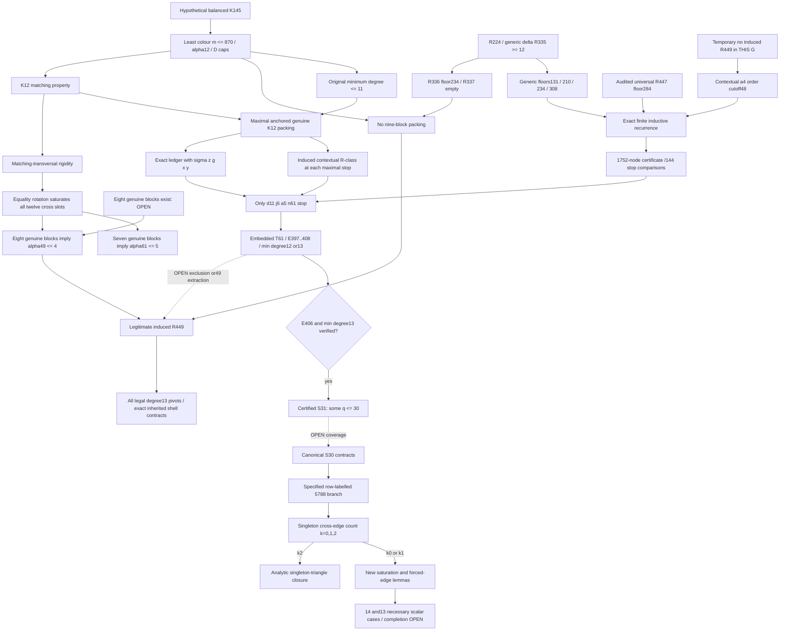

# Front-end dependency DAG

Overall bridge status: **OPEN**. The terminal-obstruction reduction is **PROVED**. Detailed statuses are tracked in `ASSUMPTION_LEDGER.md`.

## No circular back-end dependence — PROVED

The temporary no-R449 hypothesis is not an imported theorem about R449. It is the negation of extraction in one fixed original graph. All recurrence operations remain induced subgraphs of that same graph. The final conclusion is a disjunction: extraction succeeds, or T61 survives.

The inputs to the recurrence stop at lower-order generic seeds. S27, S30 and S31 are downstream filters only, not premises for forcing the outer stop.

## Interfaces that must not be collapsed

|Interface|Status|What is actually proved / missing|
|---|---|---|
|Eight genuine blocks -> R449|PROVED|Independence, clique maximality and hereditary caps verified|
|Anchored d11 plus seven genuine blocks -> R449|PROVED|The anchor is an independent representative, not an assumed clique|
|Six anchored blocks -> seven genuine unanchored blocks|OPEN|The candidate anchor needs z=0, or a different packing argument|
|Embedded T61 -> E406/delta13 parent|OPEN|Exact residual edge and minimum-degree cases remain|
|S31 q-descent -> actual outer extraction or block creation|OPEN|A changed pivot is not a changed graph or an extra clique|
|Row-labelled5788 with singleton triangle -> contradiction|PROVED|Proof does not cover missing singleton edges without further argument|
|Every T61 survivor is one of these local objects|OPEN|This is a coverage theorem, not a consequence of local status labels|