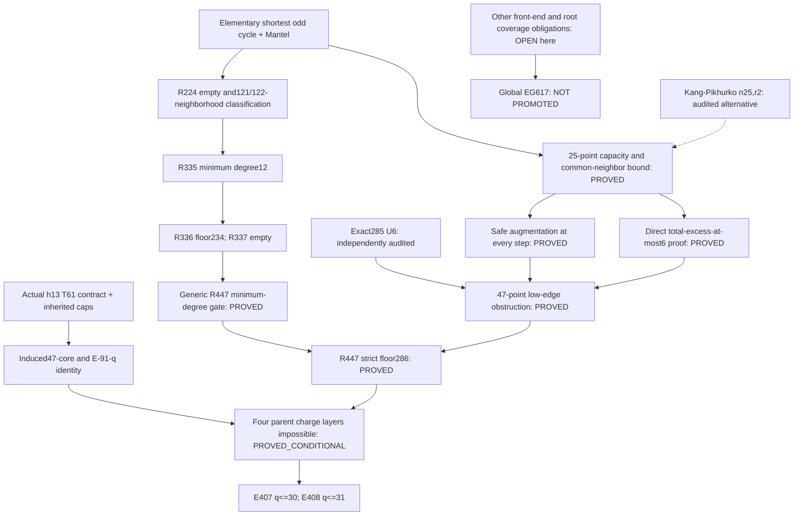

# Independent dependency DAG

Date: 2026-10-30. All statuses refer to the statements' explicit hypotheses.

## Exact input ledger

| Node | Minimal input | Status |
|---|---|---|
|C|n47,e<=285,delta>=12,alpha<=4,omega<=11;25-point triangle-free upper145|PROVED|
|A|C applied anew at every current graph; exact285 U6 only at terminal|PROVED|
|L via augmentation|A plus independently audited U6|PROVED|
|L direct|T<=6, elementary Turan, C, private-clique blockers and pointwise inequalities|PROVED|
|M|R447 including all inherited D-caps, e<=286; reconstructed R224/R335/R336/R337 chain|PROVED|
|F|M and L; no exact284 theorem or127-row certificate|PROVED|
|H|actual61-point h13 F, alpha<=5,omega<=11, induced caps; chosen degree13 pivot|PROVED_CONDITIONAL on parent contract|
|X|H and F; charges as in the matrix|PROVED_CONDITIONAL on parent contract|
|Finite arithmetic/type replay|self-contained new verifier; no sibling-code import|COMPUTATION_CERTIFIED|
|Global original problem|all other parent/coverage dependencies|OPEN here|

The exact284 Q33 theorem is audited as a cross-check, not a premise of L. Q33's minimum-degree source is credited as the starting source for M, and its omitted type classification is reconstructed here. V11, V12, MS-29, selected support unions, exact129 factorization, degree-nine assertions, and target omega<=5 are absent from every new proof path.

The two proofs of L share C and the private-clique ideas; they are not claimed to be statistically or conceptually unrelated. The augmentation path uses U6 as a theorem, while the direct path reproduces the structural contradictions under T<=6 without invoking U6.
